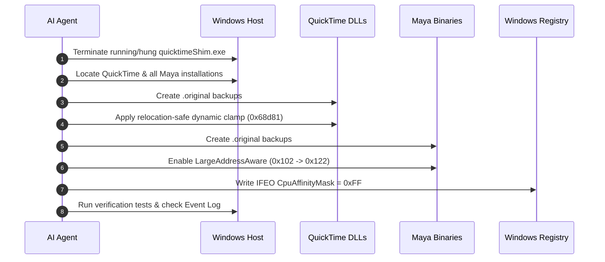

# AI Agent Autonomous Playbook: QuickTime Multi-Core & 2K/4K Compatibility Fix

> **Target Audience**: Autonomous AI Agents (e.g., OpenAI Codex, Anthropic Claude, Google Gemini) executing on Windows host systems.  
> **Mission**: Diagnose, locate, back up, and repair Apple QuickTime multi-core (> 16 threads) and high-resolution (2K/4K) crashes across QuickTime 7 and all installed Autodesk Maya versions without human intervention.

---

## 1. Quick Diagnosis & Heuristics

When a user reports:
* QuickTime Player crashes on launch or on high core-count CPUs.
* Maya Playblast output is 0 KB, missing, or reports `Error: Disk full (-34)` or `Error: -2048`.
* Playblast works for 1080p, but crashes for 2K (2048×1080 / 2560×1440) or 4K.
* Windows Event Viewer logs `0xc0000005` in `quicktimeShim.exe` at offset `0x001f502d` or `0x00068d74`.

**Root Cause**:
1. Apple's Windows port of `GetNumberOfProcessors()` ignores the caller's requested slice/thread limit, returning all logical processors (e.g., 32), exceeding internal codec tables.
2. For > 1080p (2K/4K), callers deliberately request a 4-slice limit to prevent memory exhaustion, but unpatched QuickTime attempts 8+ slices with ~17.8 MB buffers each.
3. 32-bit helper executables (`quicktimeShim.exe`) lack `IMAGE_FILE_LARGE_ADDRESS_AWARE` and run out of 2GB virtual memory, triggering a NULL pointer crash in `memset`.

---

## 2. Standard Operating Procedure (SOP) for Agents

Follow these steps in strict sequence.



---

### Step 1: Pre-flight Safety & Process Cleanup
Before touching any binary files, terminate any lingering zombie `quicktimeShim.exe` processes to prevent Windows file locking (`WinError 32: Access is denied`):

```powershell
Stop-Process -Name "quicktimeShim" -Force -ErrorAction SilentlyContinue
```

---

### Step 2: System Discovery & Target Identification

Locate the target components across the host:

1. **QuickTime Installation Directory**:
   * Default: `C:\Program Files (x86)\QuickTime`
   * Registry Query: Check `HKLM\SOFTWARE\WOW6432Node\Apple Computer, Inc.\QuickTime` -> `InstallDir`.
   * Essential Files:
     * `QTSystem\QuickTimeH264.qtx`
     * `QTSystem\QuickTime.qts`
     * `QTSystem\AppleProResDecoder.qtx` (optional)
     * `QuickTimePlayer.exe`
2. **Autodesk Maya Installations**:
   * Glob pattern: `C:\Program Files\Autodesk\Maya*\bin\quicktimeShim.exe`
   * Discover **ALL** installed versions (e.g., Maya 2018, 2020, 2022, 2023, 2024, 2025, 2026, 2027+).

---

### Step 3: Binary Hot-Patching (CRITICAL RULES)

> [!CAUTION]
> **PE Base Relocation Table Rule**:
> `QuickTimeH264.qtx` has an absolute memory reference at file offset `0x68d77` (`call dword ptr [0x683ca3d4]`). The PE relocation table (`.reloc`) contains a relocation fixup slot for offset `0x68d79`.
> **YOU MUST NEVER SHIFT OR MOVE THE FIRST 17 BYTES** (`0x68d70` to `0x68d80`). Shifting instructions will corrupt the relocation target after ASLR, crashing `quicktimeShim.exe` with `0xc0000005`.

#### Patch A: `QuickTimeH264.qtx` — Dynamic Caller-Aware Clamp
* **File**: `<QuickTime>\QTSystem\QuickTimeH264.qtx`
* **File Offset**: `0x68D81`
* **Target Size**: 15 bytes
* **Assembly Implementation**:
  ```assembly
  ; At this point, eax contains procs (e.g. 32).
  ; The caller-requested limit is passed on the stack at [esp + 0x28]:
  ; - For <= 1080p: caller pushed 8
  ; - For > 1080p (2K/4K): caller pushed 4
  cmp eax, dword ptr [esp + 0x28] ; 3b 44 24 28
  jle +4                          ; 7e 04
  mov eax, dword ptr [esp + 0x28] ; 8b 44 24 28
  add esp, 0x24                   ; 83 c4 24
  ret                             ; c3
  nop                             ; 90
  ```
* **Exact Patch Hex**: `3b 44 24 28 7e 04 8b 44 24 28 83 c4 24 c3 90`

#### Patch B: `QuickTime.qts` — Secondary Core & Carbon Clamps
* **File**: `<QuickTime>\QTSystem\QuickTime.qts`
* **Patch 1**: Offset `0x2EB3E1` (Secondary CPU detector)
  * Replacement (11 bytes): `83 f8 08 7e 02 b0 08 83 c4 24 c3` (`cmp eax, 8; jle +2; mov al, 8; add esp, 0x24; ret`)
* **Patch 2**: Offset `0x9CA11` (`MPProcessors()` Carbon API)
  * Replacement (11 bytes): `83 f8 08 7e 02 b0 08 83 c4 24 c3`

#### Patch C: `AppleProResDecoder.qtx` — ProRes Decode Threads
* **File**: `<QuickTime>\QTSystem\AppleProResDecoder.qtx` (if present)
* **Offset**: `0x4DA32`
  * Replacement (11 bytes): `83 f8 08 7e 02 b0 08 83 c4 24 c3`

---

### Step 4: Unlock 4GB LargeAddressAware on 32-bit Executables

To prevent 32-bit virtual memory exhaustion during 2K/4K exports:

1. For each executable:
   * Every discovered `quicktimeShim.exe` across all Maya versions.
   * `<QuickTime>\QuickTimePlayer.exe`.
2. Locate `e_lfanew` at offset `0x3C` (4-byte unsigned int).
3. Jump to PE Header: `pe_offset = unpack('<I', data[0x3C:0x40])[0]`.
4. Locate `Characteristics` at offset `pe_offset + 0x16` (2-byte unsigned short).
5. Inject `IMAGE_FILE_LARGE_ADDRESS_AWARE` (bit `0x0020`):
   ```python
   new_characteristics = characteristics | 0x0020
   # Typically transforms 0x0102 -> 0x0122
   ```
6. Write back 2 bytes into the executable.

---

### Step 5: Configure Windows Registry IFEO CPU Affinity

Inject OS-level scheduling affinity masks as a safeguard against third-party component races:

* **Targets**: `quicktimeShim.exe`, `ExportController.exe`, `QuickTimePlayer.exe`
* **Registry Paths**:
  * `HKLM\SOFTWARE\Microsoft\Windows NT\CurrentVersion\Image File Execution Options\<Target>`
  * `HKLM\SOFTWARE\WOW6432Node\Microsoft\Windows NT\CurrentVersion\Image File Execution Options\<Target>`
* **Value**:
  * Name: `CpuAffinityMask`
  * Type: `REG_DWORD`
  * Data: `0x000000FF` (First 8 logical cores)

---

### Step 6: Automated Verification

To confirm the repair was completely successful:

1. **Self-check with verification utility**:
   ```powershell
   python scripts/patch_quicktime.py --status
   ```
2. **Execute Headless/Live Maya Playblast Test**:
   ```python
   import maya.cmds as cmds
   res = cmds.playblast(
       filename=r"C:\temp\verify_2k",
       format="qt",
       compression="H.264",
       startTime=1,
       endTime=10,
       widthHeight=[2560, 1440], # 2K QHD test
       percent=100,
       quality=100,
       viewer=False,
       forceOverwrite=True
   )
   assert os.path.exists(r"C:\temp\verify_2k.mov")
   assert os.path.getsize(r"C:\temp\verify_2k.mov") > 1000
   ```
3. **Verify Windows Event Log**:
   Query `Application Error` log for any crashes of `quicktimeShim.exe` in the last 5 minutes:
   ```powershell
   Get-WinEvent -FilterHashtable @{LogName='Application'; ProviderName='Application Error'} -MaxEvents 5
   ```
   Ensure no `0xc0000005` errors are present.

---

## 3. Autonomous Python Script Reference

For one-click automated execution by an agent, invoke the bundled zero-dependency Python script:

```powershell
# Automatically discovers, backs up, and patches all targets:
python scripts/patch_quicktime.py --apply

# To restore pristine backups:
python scripts/patch_quicktime.py --restore
```
