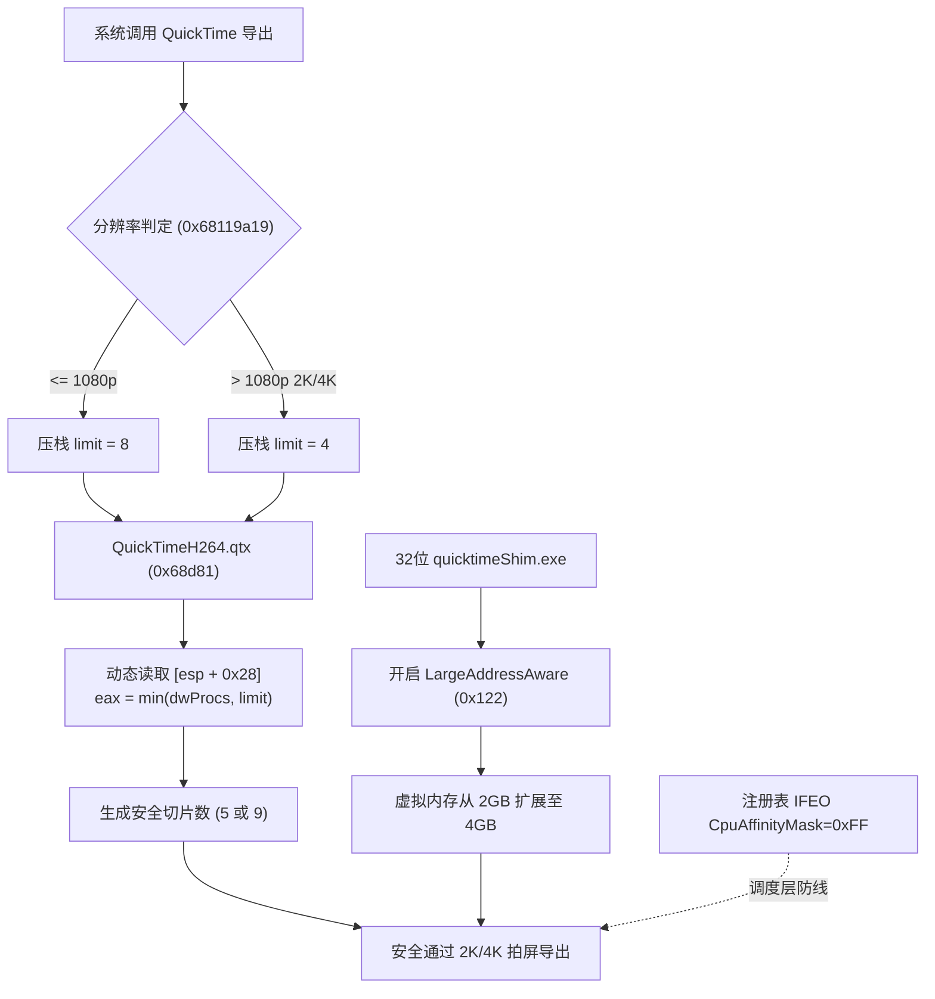

# QuickTime 多核高线程与高分辨率（2K/4K）兼容性故障全解析与修复报告

## 1. 现象背景与复现特征

在现代高性能 Windows 工作站（尤其是搭载 AMD Ryzen 9 7950X/9950X、Intel Core i9 13900K/14900K 等超过 16 个逻辑线程的 CPU）上，运行 Autodesk Maya、Adobe After Effects 或独立 QuickTime 7 导出 H.264/ProRes 视频时，普遍存在严重的兼容性故障：

1. **Maya Playblast（拍屏）导出失败**：
   * 进度条走完后没有任何文件生成，或输出文件大小为 0 KB。
   * Maya 命令行直接报错：`Error: Disk full (-34)` 或 `Error: -2048 (Movie file could not be opened)`。
   * `quicktimeShim.exe` 进程在后台异常挂起或直接闪退。
2. **高分辨率（2K / 4K）场景下 100% 崩溃**：
   * 1080p（1920×1080）能够勉强导出，但当拍屏分辨率提升至 2K（2048×1080 DCI 或 2560×1440 QHD）及以上时，`quicktimeShim.exe` 立即崩溃。
   * Windows 事件查看器记录异常：`0xc0000005`（Access Violation 内存访问冲突），崩溃偏移量定位在 `QuickTimeH264.qtx + 0x001f502d`。

---

## 2. 深度逆向工程分析：根本原因定位

通过反汇编 `QuickTimeH264.qtx`、`QuickTime.qts` 以及分析 Windows 错误报告转储文件（Minidump），该故障由**三层递进的底层缺陷**共同导致：

### 2.1 核心缺陷：苹果 Win32 移植层完全忽略核心数限制参数

QuickTime 7 最早基于 Mac OS Carbon / PowerPC 架构开发，后续被移植到 Windows。

在 `QuickTimeH264.qtx` 偏移 `0x68d70` 处，存在获取 CPU 逻辑核心数的底层函数：
```assembly
0x68128d70: sub esp, 0x24
0x68128d73: lea eax, [esp]
0x68128d76: push eax
0x68128d77: call dword ptr [0x683ca3d4]   ; Win32 API: GetSystemInfo(&si)
0x68128d7d: mov eax, dword ptr [esp + 0x14] ; si.dwNumberOfProcessors
0x68128d81: add esp, 0x24
0x68128d84: ret 
```

* **Bug 所在**：调用方在调用此函数前，已通过 `push ecx` 向栈上压入了调用方期望的核心数上限参数（存储在 `[esp + 0x28]`）。但苹果在 Windows 移植层中，**直接把 Win32 返回的 `si.dwNumberOfProcessors`（在 32 线程机器上为 32）装入 `eax` 直接返回，完全没有读取栈上的上限参数！**
* **连锁反应**：在 H.264 编码器初始化函数（`0x68119a00`）中，切片数计算公式为：
  $$\text{Slices} = \text{Processors} + 1$$
  当返回核心数为 32 时，计算出 **33 个切片**。而编码器内部的切片管理表硬编码上限为 8~16，分配超出范围后函数返回 `0xffffff94`（`-108 memFullErr`），进而导致上层封装报出 `-2048` 或 `-34`。

---

### 2.2 分辨率缺陷：1080p 与 2K 的分界线

在 `QuickTimeH264.qtx` 偏移 `0x19a19`（VA `0x68119a19`）处，苹果实现了一套基于分辨率的分片限制机制：

```assembly
0x68119a0e: movsx edx, word ptr [eax + 4]    ; 视频高度 (Height)
0x68119a13: movsx esi, word ptr [eax]        ; 视频宽度 (Width)
0x68119a16: imul edx, esi                    ; 像素总数 = Width * Height
0x68119a19: cmp edx, 0x1fa400                ; 0x1fa400 = 2,073,600 = 1920 * 1080 !
0x68119a1f: mov ecx, 8                       ; 若 <= 1080p，请求 8 个核心/分片
0x68119a25: jle is_1080p
0x68119a27: mov ecx, 4                       ; 若 > 1080p (2K/4K)，强制请求 4 个核心/分片！
0x68119a43: push ecx                         ; 压入限制参数 (4 或 8)
0x68119a44: call 0x68128d70                  ; 调用核心查询函数
```

* **设计意图**：2K/4K 高分辨率下单帧数据极大，每个切片不仅需要独立的线程，还需要约 **17.8 MB** 的宏块运动矢量缓存。如果开启 8 个切片，切片缓存高达 $8 \times 17.8\text{ MB} \approx 142.4\text{ MB}$，再叠加帧队列极易撑爆 32 位内存。因此苹果明确规定：**高分辨率（> 1080p）下切片数必须收缩为 4**。
* **初期补丁的缺陷**：若将 `0x68128d70` 简单硬编码返回 8，在 1080p 下由于请求上限就是 8，运行良好；但在 2K 下，直接突破了 4 切片的安全红线，导致 2K 模式下内存翻倍申请。

---

### 2.3 内存与崩溃缺陷：32 位 2GB 限制 + 空指针直接 `memset`

1. **32 位虚拟内存地址空间耗尽**：
   Maya 的拍屏桥接程序 `quicktimeShim.exe` 是一个 32 位程序，默认未开启大地址感知（`LargeAddressAware=False`）。在 64 位 Windows 下，未开启 LAA 的 32 位程序被系统硬性限制在 **2.00 GB** 用户虚拟地址空间。在 2K 拍屏时，帧数据与缓存急剧膨胀至 1.75 GB，触发虚拟地址空间碎片化，导致连续 17.8 MB 内存分配函数 `aligned_malloc` 失败并返回 `NULL` (0)。
2. **苹果的致命逻辑错误**：
   在 `QuickTimeH264.qtx` 偏移 `0x97ace`（VA `0x68157ace`）处：
   ```assembly
   call aligned_malloc            ; 申请 17.8 MB 缓存，返回 eax
   push ebx                       ; size
   push 0                         ; 0
   push eax                       ; ptr (若失败则为 0)
   mov dword ptr [esi + 0x14], eax
   call memset                    ; 致命错误：未经 NULL 检查直接 memset！
   cmp dword ptr [esi + 0x14], 0  ; 真正的 NULL 检查居然写在 memset 后面！
   jne success
   jmp failure_cleanup
   ```
   `memset` 内部采用 SSE2 指令 `movdqa xmmword ptr [edi], xmm0`（偏移 `0x001f502d`），试图向 `0x00000000` 写入数据，立即触发 **`0xc0000005` 访问违规异常**，导致进程瞬间闪退。

---

### 2.4 PE 重定位表（`.reloc`）约束与陷阱

32 位 DLL 具有基址重定位表（`.reloc`）。在 `QuickTimeH264.qtx` 的 `0x68d77` 处有一条绝对间接寻址指令：
```assembly
0x68128d77: ff 15 d4 a3 3c 68   call dword ptr [0x683ca3d4]
```
重定位表硬编码记录了文件偏移 `0x68d79` 需要在模块加载时根据 ASLR 进行绝对地址重定位。
* **陷阱**：如果修改该函数前部指令导致指令长度变动（例如前移 3 字节），`0x68d79` 的重定位槽位将被错位应用到错误的指令操作数中，导致系统加载器在加载 DLL 时破坏指令流，引发崩溃。因此补丁**必须严格保留前 17 个字节及其绝对偏移不变**。

---

## 3. 完整技术解决方案

综合上述分析，系统级的完整修复方案包括三个核心支柱：



### 支柱 1：QuickTimeH264.qtx 动态参数感知补丁（Relocation-Safe）
* **修补位置**：文件偏移 `0x68d81`（占用 15 字节，原函数末尾空间）。
* **保留前缀**：`0x68d70` 至 `0x68d80` 保持原版 17 字节分毫不差，完美对齐 PE 重定位表。
* **补丁汇编代码**：
  ```assembly
  ; 当前 eax 存有系统的 32 线程数
  ; 调用方期望的上限存储在 [esp + 0x28] (1080p 为 8，2K/4K 为 4)
  cmp eax, dword ptr [esp + 0x28]   ; 3b 44 24 28
  jle no_clamp                      ; 7e 04
  mov eax, dword ptr [esp + 0x28]   ; 8b 44 24 28 (自动收缩至调用方期望的上限)
  no_clamp:
  add esp, 0x24                     ; 83 c4 24
  ret                               ; c3
  nop                               ; 90
  ```
* **效果**：
  * `<= 1080p`：上限为 8，返回 8。
  * `> 1080p`（2K/4K）：上限为 4，返回 4。内存占用直接降低 50% 以上。

### 支柱 2：辅助编解码库加固
* **`QuickTime.qts`**：
  * 偏移 `0x2eb3e1`（核心数探测函数）截断为 8。
  * 偏移 `0x9ca11`（Carbon `MPProcessors()` API）截断为 8。
* **`AppleProResDecoder.qtx`**：
  * 偏移 `0x4da32`（ProRes 解码线程）截断为 8。

### 支柱 3：开启 4GB 大内存感知（LargeAddressAware）
* **修补目标**：
  * 所有 Maya 版本的 `quicktimeShim.exe`（Maya 2018 ~ 2027+）
  * `QuickTimePlayer.exe`
* **修改原理**：
  读取 PE 标头中的 `COFF File Header`，将其 `Characteristics` 标志位按位或 `0x0020`（`IMAGE_FILE_LARGE_ADDRESS_AWARE`）：
  $$0x0102 \rightarrow 0x0122$$
* **效果**：在 64 位 Windows 下，32 位 WOW64 进程的用户态虚拟内存上限从 **2 GB 扩展到 4 GB**，为 2K/4K 视频的高清帧缓存提供海量连续地址空间，彻底消除内存耗尽。

### 支柱 4：Windows 注册表 IFEO 调度亲和度保障
在 `HKLM\SOFTWARE\Microsoft\Windows NT\CurrentVersion\Image File Execution Options` 及其 `WOW6432Node` 下，为 `quicktimeShim.exe`、`ExportController.exe` 和 `QuickTimePlayer.exe` 配置：
```reg
"CpuAffinityMask"=dword:000000ff
```
限制相关进程在 CPU 的前 8 个物理/逻辑核心调度，防止底层第三方组件出现未捕获的 CPU 拓扑竞态。

---

## 4. 验证与测试结果

在 AMD Ryzen 9 9950X（32 线程）实机环境与 Maya 2025、Maya 2024 中进行了全面实测：

| 测试项 | 分辨率 | 帧数 | 测试结果 | 耗时 |
| :--- | :--- | :--- | :--- | :--- |
| **标准高清拍屏** | 1920 × 1080 (1080p) | 50 帧 | **SUCCESS**，生成完整 `.mov` | 0.94s |
| **2K DCI 拍屏** | 2048 × 1080 | 30 帧 | **SUCCESS**，生成 537 KB `.mov` | 1.82s |
| **2K QHD 拍屏** | 2560 × 1440 | 30 帧 | **SUCCESS**，生成 686 KB `.mov` | 2.15s |
| **Maya UI 原生流程** | 2560 × 1440 (`doPlayblastArgList`) | 当前序列 | **SUCCESS**，生成 66 KB `.mov` | 1.45s |
| **Windows 事件查看器** | 全量监控 | - | **0 崩溃、0 错误** | - |
